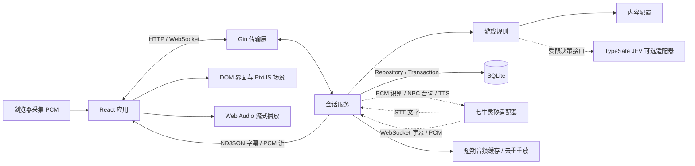

# 红烛无声 · 语音互动无限流惊悚游戏

《红烛无声》是一款以语音为主要交互方式的单人第一视角无限流惊悚游戏，以不同副本中的规则、谜团与生存抉择展开故事。当前首个副本“红烛寺”融合民俗惊悚：玩家与三位同伴入住古寺，在午后的闲谈、晚膳与夜间异响中寻找线索，通过交谈、调查和行动选择，尝试活着度过这一夜。

**按住空格说话，松开发送。** 你可以向人物追问、劝说同伴、查看物件、使用道具，也可以打断正在播放的回复。角色回应由七牛灵矽生成并配音，剧情进度、道具和生存结果由 Go 规则引擎结算。

游戏将 AI NPC 对话与 JEV 决策模型结合，让玩家说出的理由参与选择结果的判定。多条剧情分支由进食、调查、同伴状态和夜间行动交织而成：一次劝说、一次开门或一条被忽略的线索，都可能让后续遭遇与求生路线发生变化。

当前版本为本机演示原型，已接入首夜十二幕的场景、人物、道具与声音，包含从抵达、登记、晚膳到午夜求生和离寺的主线，以及进食选择、同伴核验、杯筊和死亡重试等分支。逐景实现范围见[实现索引](story/mini_script_coverage.md)（含剧透）。

## 演示与体验

**[观看游戏演示视频](demo_1080.mp4)**

游戏演示视频与[游戏内开场短片](assets/video/opening/opening.mp4)分别提供；首次了解作品可先观看演示，再按下文说明启动本机环境。

建议体验顺序：

1. 通过浏览器绘制自检，允许麦克风并进入，观看片头，在结尾片名下点击“开始游戏”或按住空格说“开始游戏”；山路远景约3秒、下车停门镜头约4秒（两张画面柔和渐变，门口镜头缓慢横移）后进入正片，首句对白与完整字幕同步开始。
2. 在山门观察周围、向同行者提问，再办理入住，感受调查与角色对话的衔接。
3. 到斋堂后表达自己的用餐选择，或尝试劝说同伴，观察人物回应与状态变化。
4. 夜间根据所见、所闻作出选择，体验语音调查、道具操作与生存分支。
5. 尝试在人物回复时按住空格打断，或说“查看手记”“保存为入夜前”，检查交互与进度保存。

本机运行需要联网、灵矽 API Key、麦克风，以及支持所需 HTML-in-Canvas 实验 API 的浏览器；具体要求见“快速启动”。

## 产品设计与潜在价值

### 目标玩家与核心体验

作品面向喜欢民俗惊悚、剧情解谜与角色互动的玩家，探索如何让“亲口问出问题、听取回答、决定是否相信”成为游戏过程。语音贯穿人物交流、物件调查和行动选择，玩家在同一个第一视角场景中完成观察与表达。

- **交流影响后续处境**：晚膳时可以表达自己的选择，也可以劝说同伴；进食状态会参与夜间分支结算。
- **声音承载线索**：更锣、敲门和环境声与场景状态对应，需要玩家结合画面作判断；可以要求重听当前内容。
- **角色保留交流空间**：固定分镜之外，可以向在场 NPC 自由提问；回复依据人物身份、当前事实与最近对话生成。
- **关键选择由玩家作出**：安全对白可以自动接续，危险操作保持等待；静音或识别失败不会替玩家作出生存选择。

核心循环为：**观察场景 → 语音调查或交谈 → 获得线索 → 作出行动选择 → 后端结算并保存 → 进入下一段剧情**。

多分支设计贯穿整个副本：四人的进食选择影响夜间同伴与换皮来客分支，调查与阅读决定可用线索和应对手段，虔诚度、杯筊及开门、逃跑等行动共同影响后续处境。玩家可以从安全节点重试，探索同一夜晚的不同剧情走向。无限流的后续内容将沿用“进入副本—发现规则—交流试探—选择求生”的结构，扩展不同主题与人物；当前可体验内容为红烛寺首夜。

### 商业化方向与验证重点

后续可探索章节付费的叙事游戏，或为新的民俗故事制作独立篇章。已有角色配置、提示词、场景布局与规则分层，为增加内容提供了组织基础；新章节仍需要编剧、美术、规则实现与体验验证。

上述方向属于产品设想，当前尚无付费或市场验证数据。下一步应通过试玩记录验证语音操作的理解成本、首夜完成率、分支重玩意愿，并实测每局云端调用成本与等待时间，再判断内容定价和持续制作方式。当前浏览器实验能力与云端依赖也需要在扩大分发前解决。

## AI 在游戏中的作用

| 环节         | 当前实现                                                        | 玩家得到的体验与规则边界                                   |
| ------------ | --------------------------------------------------------------- | ---------------------------------------------------------- |
| 语音输入     | AudioWorklet 采集 PCM，经 Go 转发至灵矽识别                     | 按住空格表达行动或问题；静音、取消和识别失败不作为游戏回合 |
| 角色对话     | 灵矽按角色提示词、当前场景事实与最近问答生成开放式回应          | 可以追问和闲聊；普通跑题不自动推进剧情或扣除虔诚度         |
| 角色声音     | 各角色与系统旁白使用独立智能体音色；固定分镜台词逐字 TTS        | 通过声音识别人物，固定剧情仍保持编排顺序                   |
| 受限语义判断 | 可选接入 TypeSafe JEV，处理劝说、神公诚意判断及部分行动选项匹配 | 自然表达可映射到受限决策；Go 校验候选、前置条件与结果      |
| 状态结算     | Go 规则引擎管理移动、道具、虔诚度、剧情标记与生死               | AI 输出不能直接发放物品、移动房间或任意改写存档            |

例如，在斋堂说“这粥有点奇怪，大家还是吃素的吧”，配置 JEV 后会结合在场人物的性格和上下文判断劝说结果，再由规则层记录各人的进食选择；向在场 NPC 追问则进入角色对话。两类请求分别处理，避免把一段生成台词直接当成已执行的行动。

### JEV 决策模型：让表达参与选择结果

JEV 在指定剧情节点承担决策判定：读取玩家原话、场景状态、人物性格与相关对话上下文，返回结构化的选择结果。在斋堂，它判断各位同伴是否接受劝说；在神公场景，它判断回答表现出的诚意并给出评分，供后续规则结算使用；在部分行动场景，它将自然表达映射到当前允许的行动选项。

玩家因此可以用自己的理由影响人物选择和后续分支。模型给出的判定仍需经过 Go 规则层校验，才能写入人物状态、剧情标记与存档；杯筊和生死等最终结果由游戏规则结算。

### AI NPC：有性格、有声音，也能接住自由提问

林岚、周砚、许栀、陆沉等角色分别维护性格、知识边界、提示词与独立音色。固定剧情之外，AI NPC 会结合当前场景和最近问答回应追问、闲聊与试探，让玩家在交流中逐步判断眼前的人是否可信。固定分镜负责叙事节奏，生成式对话提供交流空间，JEV 则在指定节点把表达转化为可结算的决策。

明确动作优先由本地规则处理。JEV 为可选依赖：未配置时，劝说与神公判断使用已有本地规则；部分未匹配表达需要澄清。门房四选一判断失败或置信度不足时停留原地。灵矽是语音识别、开放式 NPC 回复与 TTS 的必需依赖，云端失败会明确反馈，不生成本地替代 NPC 台词。

## 技术架构

### 技术栈

| 层次      | 技术                                            | 职责                                         |
| --------- | ----------------------------------------------- | -------------------------------------------- |
| 界面      | React 19、TypeScript、Vite 8                    | 状态栏、道具栏、字幕、信息面板与应用编排     |
| 样式      | CSS Modules                                     | 每个组件独立维护样式，隔离类名               |
| 场景      | PixiJS 8、WebGL、GLSL                           | 固定视角场景、纹理、氛围滤镜                 |
| HTML 纹理 | HTML-in-Canvas 实验 API                         | 将 HTML/CSS 内容绘制到 Canvas，再接入 PixiJS |
| 当前语音  | AudioWorklet、Web Audio API、七牛灵矽 WebSocket | 按住说话、云端 NPC 音频、系统读白与波形      |
| 后端      | Go 1.26、Gin、HTTP / WebSocket                  | 会话、规则结算、状态同步与请求去重           |
| 存储      | SQLite、`modernc.org/sqlite`                    | 自动存档、命名检查点、事件与 NPC 对话记录    |



后端持有游戏的权威状态。灵矽 STT 返回的完整文字交给 Go 规则层；地图、移动、调查、交付道具和存档等明确动作先在事务中结算并通过 `type=action` 推送，前端立即更新画面，再调用灵矽播报。播报失败或被打断不撤销已经执行的动作。开放式 NPC 对话仍在云端完整返回后复核状态版本并提交，云端失败不生成本地替代台词。字幕和 PCM 经 HTTP NDJSON 逐段推送，前端约缓冲 120ms 后连续播放；最终 `type=state` 表示该请求的播报流程结束，动作可能早已提交。灵矽不能直接发放道具、改变虔诚度或移动房间。

### 前端分层

| 目录                | 职责                                                 |
| ------------------- | ---------------------------------------------------- |
| `web/src/app/`      | 启动检查、页面组装、语音与会话等跨功能编排           |
| `web/src/features/` | 语音、会话、状态栏、道具栏、字幕、信息面板和调试入口 |
| `web/src/scene/`    | 场景布局、黑屏转场、PixiJS、HTML 纹理与 GLSL         |
| `web/src/shared/`   | 通用 UI、类型、工具与基础样式                        |

`shared` 不依赖上层，`scene` 不导入 `features/app`，`features` 不导入 `app`；跨功能协调放在 `app`。

### 后端分层

| 目录                          | 职责                                               |
| ----------------------------- | -------------------------------------------------- |
| `cmd/server/`                 | 环境配置、依赖装配、进程启动与关闭                 |
| `internal/transport/httpapi/` | HTTP / WebSocket 输入、路由与错误映射              |
| `internal/session/`           | 回合编排、去重、事务边界、存档与检查点             |
| `internal/game/`              | 独立于 Gin / SQL 的游戏状态与规则                  |
| `internal/content/`           | 世界、物品、NPC 配置和提示词的加载与校验           |
| `internal/storage/sqlite/`    | 会话层存储接口的 SQLite 实现                       |
| `internal/integration/linx/`  | 灵矽智能体管理、虚拟设备身份、OTA 绑定与 WebSocket |
| `internal/integration/jev/`   | 可选的劝说、诚意与行动选项语义判断适配             |

传输层通过服务接口调用会话层；会话层使用游戏规则和存储接口，由入口装配 SQLite 实现。SQL、网络适配、规则与角色配置分别维护，便于多人协作和后续替换实现。

### 交互与状态一致性

- 每次请求携带 `runId` 和 `requestId`，通过独立的 HTTP NDJSON 流接收字幕、音频和最终状态；WebSocket 用于连接状态与快照恢复。中途失败不自动重放已播的声音；相同请求 ID 的显式重试由后端去重。
- 状态、事件、NPC 对话记录和请求结果在同一事务中提交；前端按 `revision` 过滤迟到状态。
- 已识别的有效发言均有角色或系统反馈。跑题交由当前灵矽 NPC 回应，歧义进行澄清，空回应、识别中断和网络失败有明确提示。
- 玩家按下空格会中止旧 HTTP 流和云端生成，清空旧播放队列并拒绝迟到字幕；已经提交的动作保留，尚未提交的回合不结算。

当前规则引擎处理部分同义表达，并对常见否定、假设和行动询问进行保守澄清。开放式 NPC 语言必须由灵矽智能体生成，动作和奖励仍由后端规则结算。

### HTML-in-Canvas 的作用

HTML-in-Canvas 让使用 HTML/CSS 排版的内容成为 Canvas 的绘制输入。项目将它用于文字线索面板，使文字、纸张与装饰能作为一个纹理参与 GPU 滤镜。

当前渲染流程：

```text
HTML / CSS 内容
    ↓ drawable 子树与 paint 事件
drawElementImage() 绘制到 2D Canvas
    ↓ Texture.from(canvas) / texture.source.update()
PixiJS Sprite
    ↓ GLSL Filter
最终画面
```

对应实现位于 `web/src/scene/html_clue/`；状态栏、道具栏和字幕使用 React DOM。房间画面与氛围滤镜分别位于 `scene/background/`、`scene/effects/`，通过独立的 GLSL 文件维护变暗、故障和晕眩等效果。

启动探针位于 `web/src/shared/lib/htmlCanvasProbe.ts`，与线索面板共用 `configureHtmlCanvas()` 配置。探针验证 HTML 到 2D Canvas 的实际绘制；纹理上传、shader 和复杂 HTML 内容仍需在目标浏览器中单独验证。线索面板具有加载、就绪和失败反馈。

本机演示将此实验能力作为必要条件，检测失败时显示启用说明，不提供普通 HTML 的游戏内降级体验。

## 快速启动

### 1. 准备环境

- Node.js 22.12+、npm。
- Go 1.26+。
- 支持所需 HTML-in-Canvas 实验 API 的 Chrome / Chromium，启用方式见下文。

SQLite 使用纯 Go 驱动，无需单独安装数据库服务。以下命令均在仓库根目录运行：

```sh
npm ci
go mod download
cp -n .env.example .env
# 在 .env 中填写 LINX_API_KEY，再启动
npm run dev
```

`npm run dev` 先启动 Go（或复用已运行的匹配服务），核对健康检查中的 `openingContract: mini_arrival_v1`，并通过 `GET /api/story/opening` 确认返回第一幕后才启动 Vite。检查过程只读，不恢复或创建存档；发现旧服务占用 `8787` 时会提示先停止旧服务。按 `Ctrl+C` 关闭本次启动的进程。

| 地址                                                          | 用途         |
| ------------------------------------------------------------- | ------------ |
| [127.0.0.1:5173](http://127.0.0.1:5173/)                      | 开发页面     |
| [127.0.0.1:8787/api/health](http://127.0.0.1:8787/api/health) | 后端健康检查 |

Vite 监听 `0.0.0.0:5173`，同一局域网的电脑可通过 `http://<本机局域网 IP>:5173/` 访问。`npm run dev` 和 `npm run dev:web` 共用 `vite.config.ts` 的监听配置。Go 仍监听 `127.0.0.1:8787`，网页的 `/api` 和 WebSocket 请求由 Vite 代理，其他电脑不需要直接访问后端端口。

局域网 HTTP 可用于打开页面和开发调试，但麦克风需要可信的 HTTPS 或 `localhost` 安全上下文。完整语音体验可配置受访问电脑信任的 HTTPS 证书，或通过 SSH 转发后使用另一台电脑上的 `localhost` 地址。访问端浏览器同样必须通过下方的实验 API 绘制自检。

### 2. 配置浏览器

参考 [WICG 开发者试用说明](https://github.com/WICG/html-in-canvas#developer-trial-information)，在支持这些实验能力的 Chrome / Chromium（例如 Chrome Canary）中，将以下开关设为 `Enabled`，点击 **Relaunch** 重启浏览器后打开页面：

```text
chrome://flags/#canvas-draw-element
chrome://flags/#enable-experimental-web-platform-features
```

网页以**实际绘制结果**判断能否运行，无法读取 `chrome://flags` 的状态。浏览器已经提供所需能力时，即使总开关没有开启，绘制自检通过也可进入。

每次加载页面都会执行启动检查：

1. 确认 `requestPaint()` 与 `drawElementImage()` 可调用。
2. 创建 16×16 Canvas，绘制包含两种已知颜色的 HTML 元素。
3. 在 `paint` 事件中绘制并读取两处像素，核对颜色。
4. 全部通过后才懒加载游戏，通过 `GET /api/story/opening` 只读显示第一幕“大巴抵达红烛寺”。

接口缺失、绘制异常、像素不符或等待超过 5 秒，都会停留在说明页并显示检测信息。检测中切到后台会取消本次等待，回到前台重新检测；已进入的游戏不会因切换窗口重新挂载。演示和调试入口也必须通过自检。

当前页面在浏览器检查与语音准备后播放片头，片头结束后提示说“开始游戏”。加载第一幕的 `GET /api/story/opening` 本身只读；开启游戏语音连接时会通过 `POST /api/sessions` 创建新局。当前片头界面没有显示“继续上次进度”按钮；后端保留 `POST /api/sessions/resume` 恢复接口，页面恢复入口仍需完善。刷新后重新进入会创建新局，因此不要把刷新作为恢复进度的方式。

### 3. 启用语音

绘制自检通过后，在“开启语音会话”页面点击“允许麦克风并进入”，完成麦克风授权和音频初始化。片头结束后**按住空格说“开始游戏”，松开发送**；之后移动、道具与面板操作均可通过语音表达。NPC 回复时按住空格会立即打断播放与旧请求，再开始录音。未按空格时不运行语音识别，避免将灵矽的声音当作玩家输入。当前进入游戏需要麦克风授权；仅观看仓库中的演示视频无需授权。

一次按住只提交一个回合：松开后等待识别器收齐最终文本，再发送命令；纯静音不提交，识别不完整会提示重说。输入框中的空格不触发录音；窗口失焦、切到后台或焦点进入输入框时取消本次录音，返回后需重新按住空格。

麦克风通过 AudioWorklet 输出 16kHz / 单声道 / PCM16LE，经 Go WebSocket 转发给灵矽识别，需要联网。开发调试可注入文本，真实麦克风的音量、噪声和回声仍需在演示设备上体验。界面只显示录音、识别与回应状态，不显示“听见你说”的转写文字。

## 如何开发

### 启动与调试

前端代码与 CSS 由 Vite 热更新。Go 源码以及嵌入的 JSON / Markdown 配置修改后，需要重启 Go；`npm run dev` 当前不提供后端热重载。

需要分开观察日志时，使用两个终端：

```sh
# 终端一：后端
go run ./cmd/server
```

```sh
# 终端二：前端
npm run dev:web
```

[开发调试页面](http://127.0.0.1:5173/?debug=1) 提供识别文本注入，经同一条后端规则执行，便于验证操作与状态同步。它需要通过浏览器绘制自检，执行的操作会正常写入存档。

`npm run dev` 页面可按 `Ctrl+E`，或点击画面下方的“下一场景”跳过当前剧情场景。跳转停在下一场景的首镜头，补齐必需道具和状态，保留已有吃粥选择与调查；也会依次展示神公与假同伴分支，结局后不循环。输入框内及输入法组合期间不触发，长按不连跳。跳转会保存进度；生产构建仅在显式 `?debug=1` 页面提供此功能，仍需通过浏览器能力检查。

### 新增界面与场景

所有前端目录使用 `lower_snake_case`，组件名使用 `PascalCase`。组件视图、样式和专用逻辑就近维护：

```text
web/src/features/example_panel/
  index.tsx          导出 ExamplePanel
  style.module.css   组件专属样式
```

新增信息面板放在 `features/overlays/`，场景与滤镜放在 `scene/`，跨功能控制放在 `app/`。使用 `@/` 导入源码，每个组件维护自己的 CSS Module；共享基础样式位于 `shared/styles/`。单个源码或组件样式文件保持在 300 行以内。

运行素材存放在 `web/public/art/`，原始素材位于 `assets/`。正式场景由 `assets/scenes/*/layout.json` 定义人物、道具与前景的坐标、状态和遮挡，再由 `scene/authored_scene/` 组合呈现；未使用该组合的场景由 `story_art/` 提供画面。`npm run assets:slice` 用于早期界面概念图的切片，不负责生成正式剧情的全部素材。新增场景需要同步布局、交互热点与后端规则。

### 管理 NPC 与物品

```text
internal/content/
  world.json                 初始世界与持有物品
  items.json                 物品定义
  narrator/
    profile.json             系统旁白身份与音色
    prompt.md                播报边界与表达方式
  npcs/<npc_id>/
    profile.json             身份、头像、音色映射、对话与交换规则
    prompt.md                性格、表达方式与知识边界
```

每个 NPC 独占目录，目录名与配置 ID 保持一致。新增物品先加入 `items.json`，在 NPC 配置中引用物品、奖励和条件；修改配置后重启 Go。加载器会校验字段、ID、台词、提示词和物品引用。

当前动作与奖励仍由配置驱动的规则执行。`voice.profile`、`providerVoiceId` 和 `prompt.md` 用于灵矽智能体配置；启动时先校验平台可用音色，再按精确名称准备七个角色与旁白的 `1024-<role>` 智能体。`providerVoiceId` 只初始化新建智能体，已有智能体保留灵矽后台选择的音色；重启时提示词和其他运行配置照常同步。林岚、周砚、许栀、陆沉、慧普、神公及主角心声各用独立音色，固定分镜台词逐字云端 TTS；系统操作使用旁白音色。每次连接通过 `X-Agent-ID` 选择角色，复用同一虚拟设备，无需为旁白再绑定硬件或设备。

Go 管理虚拟设备、OTA 和设备绑定，同时提供灵矽音频识别代理。录音连接收到 STT 后终止自动 LLM/TTS，识别文字经游戏规则处理，再建立受规则控制的回复连接；识别连接中的自动音频不会传给前端。当前按本轮角色选择对应智能体，整体方案见 [NPC 交互设计](docs/design/voice-and-npc.md)。

### 本地存档与环境配置

默认数据库为 `.local/data/nightwatch.db`，首次启动自动创建。每次提交动作后保存进度；命名检查点保存世界与 NPC 对话记录，读取时创建新的 `runId`，隔离旧分支请求。可说“保存为入夜前”“回到入夜前”建立和读取检查点。服务重启保留数据库；自动存档恢复由 `POST /api/sessions/resume` 提供，当前页面入口限制见“快速启动”。本机多个标签页共享自动存档槽，新局会更新该槽，应避免并行试玩互相覆盖。

需要独立的开发数据时指定另一个数据库：

```sh
NIGHTWATCH_DB=.local/data/dev.db npm run dev
```

| 环境变量                 | 默认值                               | 作用                                                |
| ------------------------ | ------------------------------------ | --------------------------------------------------- |
| `NIGHTWATCH_DB`          | `.local/data/nightwatch.db`          | SQLite 文件路径                                     |
| `PORT`                   | `8787`                               | Go 服务监听端口                                     |
| `LINX_API_KEY`           | 无                                   | 必填；启动时用于测试智能体管理及设备绑定            |
| `LINX_API_BASE`          | `https://xrobo.qiniu.com`            | 灵矽平台 API 地址                                   |
| `LINX_WS_URL`            | OTA 返回的地址                       | 可选覆盖 WebSocket 地址；远程连接要求 WSS           |
| `LINX_OTA_URL`           | `https://xrobo.qiniuapi.com/v1/ota/` | 虚拟设备注册与连接凭证获取                          |
| `LINX_DEVICE_FILE`       | `.local/linx/device.json`            | 本机持久化设备身份，权限为 `0600`，已忽略提交       |
| `LINX_KEEPER_AGENT_ID`   | 自动查找 `1024-keeper`               | 守夜人测试智能体 ID                                 |
| `LINX_NARRATOR_AGENT_ID` | 自动查找 `1024-narrator`             | 系统旁白测试智能体 ID                               |
| `LINX_DEVICE_ID`         | 自动生成虚拟 MAC                     | 可选的首次设备 ID；已有身份文件后不能改成另一台设备 |
| `JEV_API_KEY`            | 无                                   | 可选；启用 TypeSafe JEV 语义判断                    |
| `JEV_API_BASE`           | `https://api.typesafe.ai`            | JEV API 地址                                        |

`.env` 会在 Go 服务启动时读取，进程环境变量优先。仓库提供 [.env.example](.env.example) 作为模板，真实 Key 不应提交。`LINX_API_KEY` 为必填。配置后自动准备七个角色与旁白的 `1024-<role>` 智能体，生成虚拟设备、OTA 激活并绑定到守夜人，通过每轮角色路由复用设备，不需要连接 ESP32。管理 API Key 仅用于管理 API，WebSocket 使用 OTA 返回的设备令牌。不要删除或提交身份文件。

`/api/health` 的 `linx.bound` 表示绑定完成；`linx.verified` / `qiniuConnected` 只在实际收到一轮有效云端回复后变为 `true`，并记录 `lastReplyAt`。当前 NPC 回应和系统播报按回合建立并关闭云端连接，因此这是最近一轮的验证结果，不表示始终存在一条在线连接。详细联调流程与限制见 [灵矽虚拟设备接入](docs/development/linx.md)。

开发启动脚本的健康检查和 Vite 代理固定使用 `8787`；调整 Go 端口时，需要同步修改 `scripts/dev.mjs` 与 `vite.config.ts`。上述变量可以通过启动命令或进程环境传入，Go 服务也会自动读取根目录 `.env`。

开发阶段直接使用最新数据结构，不维护旧数据库 / 存档迁移。结构变化后使用新的开发数据库；详细事务与回档设计见 [进度与本地存档](docs/design/progress-and-saves.md)。

## AI 辅助制作与协作流程

AI 同时参与运行时交互和内容制作。当前仓库可核对的制作过程包括：

| 环节             | AI 的工作                                | 约束与可检查产物                                                                                                                                                                                             |
| ---------------- | ---------------------------------------- | ------------------------------------------------------------------------------------------------------------------------------------------------------------------------------------------------------------ |
| 场景、人物与道具 | 使用 image_gen 生成图像与语义状态变体    | [素材制作说明](assets/generation/README.md)、[生成规范](assets/generation/generation_specs.json)、[制作清单](assets/generation/production_manifest.json)记录参考、提示词与当前完成状态；布局配置负责实际组合 |
| 开场短片         | 使用 Doubao-Seedance-2.5 生成片头        | [镜头脚本](assets/generation/opening_video_prompt.md)与[生成记录](assets/generation/opening_video_production.json)保留输入依据；片头与游戏演示视频分别维护                                                   |
| 角色配置         | 以提示词定义人物性格、知识边界和表达方式 | [NPC 配置](internal/content/npcs/)按角色隔离；内容加载器校验 ID、引用与提示词，游戏规则复核行动结果                                                                                                          |
| 编码协作与验收   | 通过项目约定约束编码助手和人工修改       | [AGENTS.md](AGENTS.md)规定分层、命名、文件规模和提交检查；自动检查、测试与实际页面验证用于验收                                                                                                               |

这一流程把重复的素材生成交给 AI，并把输出组织为可校验的配置和固定资源路径。同一素材状态的修改覆盖当前文件，不保留多份版本；开发过程通过 Git 提交和 PR 记录追踪。当前未提供人工工时对照或效率提升比例，制作产物与工程检查作为可核对依据。

模块职责与协作边界见[代码架构](docs/architecture.md)：界面与语音、场景与素材、规则与会话、内容配置分别维护。成员署名及个人贡献需要结合实际参与情况补充，不能仅从模块目录推定。

## 构建与检查

提交前运行：

```sh
npm run check:architecture
npm run format:check
npm run test:web
npm run build
go test -race ./...
```

架构检查覆盖目录命名、CSS Modules、导入大小写、依赖方向与文件规模；构建包含 TypeScript 检查。前端测试覆盖绘制自检与语音 / 请求反馈，Go 测试覆盖配置、规则、存储、回档及 HTTP / WebSocket。前端使用 Prettier，Go 使用 gofmt。

`npm run build` 将前端产物输出到 `dist/`。构建后运行 `go run ./cmd/server`，可通过 [127.0.0.1:8787](http://127.0.0.1:8787/) 访问由 Go 提供的完整网页，无需启动 Vite；浏览器实验功能与麦克风要求保持一致。

## 设计与开发文档

| 文档                                                    | 内容                                       |
| ------------------------------------------------------- | ------------------------------------------ |
| [首夜分镜脚本（含剧透）](story/mini_script.md)          | 当前故事、角色与分支设计                   |
| [逐景实现索引（含剧透）](story/mini_script_coverage.md) | 各场景规则、镜头与声音的实现范围           |
| [素材制作记录](assets/generation/README.md)             | AI 图像与视频制作依据、清单与当前资源      |
| [技术方案](docs/technical-plan.md)                      | 技术选型、交互框架、实验能力与后续接入方向 |
| [灵矽虚拟设备接入](docs/development/linx.md)            | 无硬件激活、云端台词与音频、诊断与限制     |
| [代码架构](docs/architecture.md)                        | 完整目录、依赖边界与模块职责               |
| [NPC 交互设计](docs/design/voice-and-npc.md)            | 语音意图、角色性格、音色与互动奖励方案     |
| [进度与本地存档](docs/design/progress-and-saves.md)     | 自动保存、检查点、事务与分支恢复           |
| [素材与切图](docs/design/assets-and-slicing.md)         | 资源组织、切图方法与当前素材限制           |
| [协作约定](AGENTS.md)                                   | 命名、样式隔离、分层和提交检查要求         |

当前实现以代码与逐景实现索引为准；早期技术方案中的后续设想不代表已经上线的功能。商业化方向尚待试玩和成本验证。
