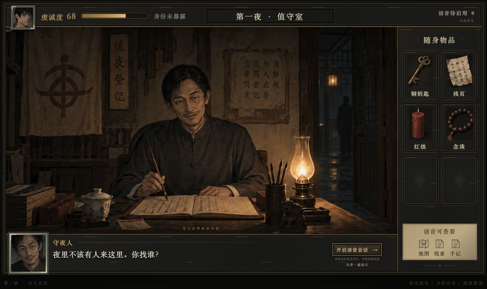

# 第一夜 · 语音密室网页原型

基于 v2 界面概念图制作的初始网页。固定视角、旧纸与灰褐美术风格，包含值守室与走廊两个测试房间。剧情、角色与数值都仍是占位内容。



## 本机启动

需要 Node.js 22.12+ 和 Go 1.26+。SQLite 使用纯 Go 驱动，无需安装额外数据库服务。素材已经切好，首次运行只需安装依赖：

```sh
npm install
go mod download
npm run dev
```

打开 [http://127.0.0.1:5173/](http://127.0.0.1:5173/)。Go/Gin 服务使用 `127.0.0.1:8787`，前端通过 Vite 代理访问。

进入游戏前会强制检查 HTML-in-Canvas 的 `requestPaint()` 和 `drawElementImage()` 是否可调用。未通过时只展示启用说明，不加载游戏、不创建 / 读取会话，也不能观看演示或通过调试参数绕过。请使用最新版 Chrome Canary，将以下两个开关设为 Enabled，点击 Relaunch 重启浏览器后重新打开本页：

```text
chrome://flags/#canvas-draw-element
chrome://flags/#enable-experimental-web-platform-features
```

启用方式依据 [WICG 开发者试用说明](https://github.com/WICG/html-in-canvas#developer-trial-information)。网页根据实际 API 能力判断，不能读取浏览器内部的开关值；刷新和重新聚焦页面都会重新检测，不保存“我已开启”一类可绕过检查的确认。

首次进入可开启语音会话并允许麦克风。正式游戏使用持续识别，不按住说话，不用鼠标或键盘操作道具和房间。也可在开启会话前选择“先看一遍演示”，无需麦克风即可观看游戏状态驱动的流程。

当前是**规则与浏览器语音演示模式**，不是已经接通七牛的 AI 版本。地图、物品、人物状态和操作结果由 Go 后端统一管理；语音转写暂时使用浏览器的 Web Speech API，NPC 读白暂时使用浏览器语音合成。Chrome 的识别服务可能需要联网；真实麦克风、回声和打断体验需要在比赛浏览器中实测。七牛实时语音、模型理解及设备身份仍待接入，不会显示虚假的七牛连接状态。

## 可以尝试的语音表达

| 说法 | 操作 |
| --- | --- |
| 看看地图 / 打开地图 | 打开已知区域地图 |
| 去走廊 / 回值守室 | 切换房间 |
| 看看账本 / 看看登记册 | 调查桌上的登记册并记录线索 |
| 看看铜钥匙 / 看看残页 | 展示物品详情 |
| 把铜钥匙给守夜人 | 交付钥匙，取得通行凭 |
| 看看手记 / 看看线索 | 查看已经发现的线索 |
| 看看我的东西 / 打开背包 | 查看随身道具 |
| 返回 / 关掉地图 | 收起信息层 |
| 暂停游戏 / 继续游戏 | 暂停与恢复 |
| 关闭声音 / 打开声音 | 关闭或开启读白和环境声，聆听不关闭 |
| 出现故障 / 我头晕了 | 测试场景 shader 效果 |
| 保存为初见 / 保存为入堂前 | 建立命名检查点，包含世界进度与当前 NPC 对话记录 |
| 回到初见 / 读取检查点入堂前 | 读取检查点并建立新分支 |
| 看看存档 / 看看检查点 | 查看最近八个检查点名称 |
| 继续上次进度 / 保存游戏 | 继续自动存档 / 确认当前进度已保存 |
| 重新开始 | 开始新一局，保留原分支和命名检查点 |
| 帮助 | 展示语音操作说明 |

规则演示仅识别部分同义表达，尚不具备完整开放式 AI 理解。与守夜人交谈时，部分虔诚或质疑的表达会影响虔诚度；地图等系统操作不会扣除虔诚度。物品或接收者不明确时会追问，重复请求不会重复发放道具。

规则模式已为常见的否定、假设与行动询问增加保守检查，例如“我不去走廊”“如果把钥匙给守夜人会怎么样”会回应并澄清，不直接执行。带标点的回房间指令仍按移动处理；检查点名称按完整名称读取，不把名称中的否定词当成指令。复杂句子的完整语义理解仍待 AI 接入。

已识别的发言必须得到角色或系统回应：普通跑题走 NPC 兜底，不自动扣虔诚度或推进剧情；无人场景、无法执行的行动和对象不明都有反馈。识别未收句、空回应和请求失败也提供系统提示，HTTP 请求限时处理，避免一直停在等待中。任意话题的自然接话仍待 AI 接入。

## 项目结构

```text
web/src/app/            页面组装与跨功能编排
web/src/features/       状态栏、道具、对白、语音、会话、信息面板
web/src/scene/          房间、PixiJS、HTML-in-Canvas 与 GLSL
web/src/shared/         通用 UI、CSS 变量与状态契约
web/public/art/         切图素材与走廊背景
internal/content/       初始世界、物品与每个 NPC 的配置 / 提示词
internal/game/          独立于 SQL / Gin 的游戏规则
internal/session/       回合、自动存档、检查点及事务接口
internal/storage/sqlite/ SQLite 存储实现
internal/transport/httpapi/ HTTP / WebSocket 适配
cmd/server/             依赖装配与进程入口
scripts/                启动、切图与架构检查
assets/                 概念图与场景原始素材
docs/                   架构、技术方案、设计和素材说明
```

游戏会自动写入 `.local/data/nightwatch.db`，刷新、关闭浏览器或重启 Go 后继续最近进度。初次打开自动建立存档；本机多个标签页共用这个自动存档槽。需要独立的演示数据时，可使用 `NIGHTWATCH_DB=.local/data/demo.db npm run dev` 指定另一个数据库。

每个操作的背包、状态、事件、当前守夜人对话记录和请求去重结果在同一事务中提交；提交失败不会先显示成功。命名检查点同时恢复世界和角色记忆，读取时创建新 `runId`，旧分支请求不能改变新进度；会话 ID 保持稳定，`revision` 继续递增，方便网页过滤迟到消息。重开仍可读取本会话之前建立的检查点，同名检查点会要求另取名字。

详细实现与后续事项见 [剧情进度与本地存档](docs/design/progress-and-saves.md)。当前 NPC 仍是配置驱动的规则回应，对话记录为未来 AI 上下文准备；短暂 shader 和音频播放位置不随存档恢复。

切换房间时，房间画面先淡出至全黑，短暂停留后再淡入；房间名、场景和对白在全黑时同步切换，全程约 0.9 秒。同一房间的普通操作不会触发转场。

## 切图与 HTML-in-Canvas

```sh
npm run assets:slice
```

这会按固定坐标重新生成房间、头像、道具等 8 张 WebP，并保存 `web/public/art/slices.json`。原始概念图不会被修改，UI 文字、边框和数值由网页重新绘制。

原图是合成画面，值守室 NPC 目前仍与房间背景合在同一张图里；独立头像和道具已经切开。后续若需要 NPC 离场、换装或完整骨骼动画，需要再补人物透明层与无遮挡背景。

账本通过“HTML → Canvas 纹理 → PixiJS”参与渲染。应用入口先检查所需实验 API，缺少能力时停留在启用说明页，已移除普通 HTML 的游戏内回退。API 检查通过只表示接口已提供；目标 Chrome 上的实际纹理绘制、shader 和语音仍需单独联调。

账本显示加载反馈；成功绘制后才切为就绪，绘制失败或等待超过 5 秒会明确提示通过语音返回并重新打开，不以空白画面代替错误反馈。

前端组件采用 `dialogue_panel/index.tsx` + `style.module.css` 的结构，导出组件 `DialoguePanel`；所有目录均为小写下划线。目录分工、NPC 配置方法和依赖边界见 [代码架构](docs/architecture.md)，协作约定见 [AGENTS.md](AGENTS.md)。

## 构建与验证

```sh
npm run check:architecture
npm run format:check
npm run test:web
npm run build
go test -race ./...
```

构建后运行 `go run ./cmd/server`，可直接通过 [http://127.0.0.1:8787/](http://127.0.0.1:8787/) 访问构建产物。

仅用于开发的 [调试页面](http://127.0.0.1:5173/?debug=1) 允许注入语音转写文本，经同一条后端规则执行，便于在不采集真实麦克风的情况下验证交互。普通游戏页面不显示这组测试控件。

技术接入与后续事项见 [技术方案](docs/technical-plan.md)，语音判断、角色音色、人设与互动奖励见 [NPC 交互设计](docs/design/voice-and-npc.md)，美术切图见 [素材说明](docs/design/assets-and-slicing.md)。
